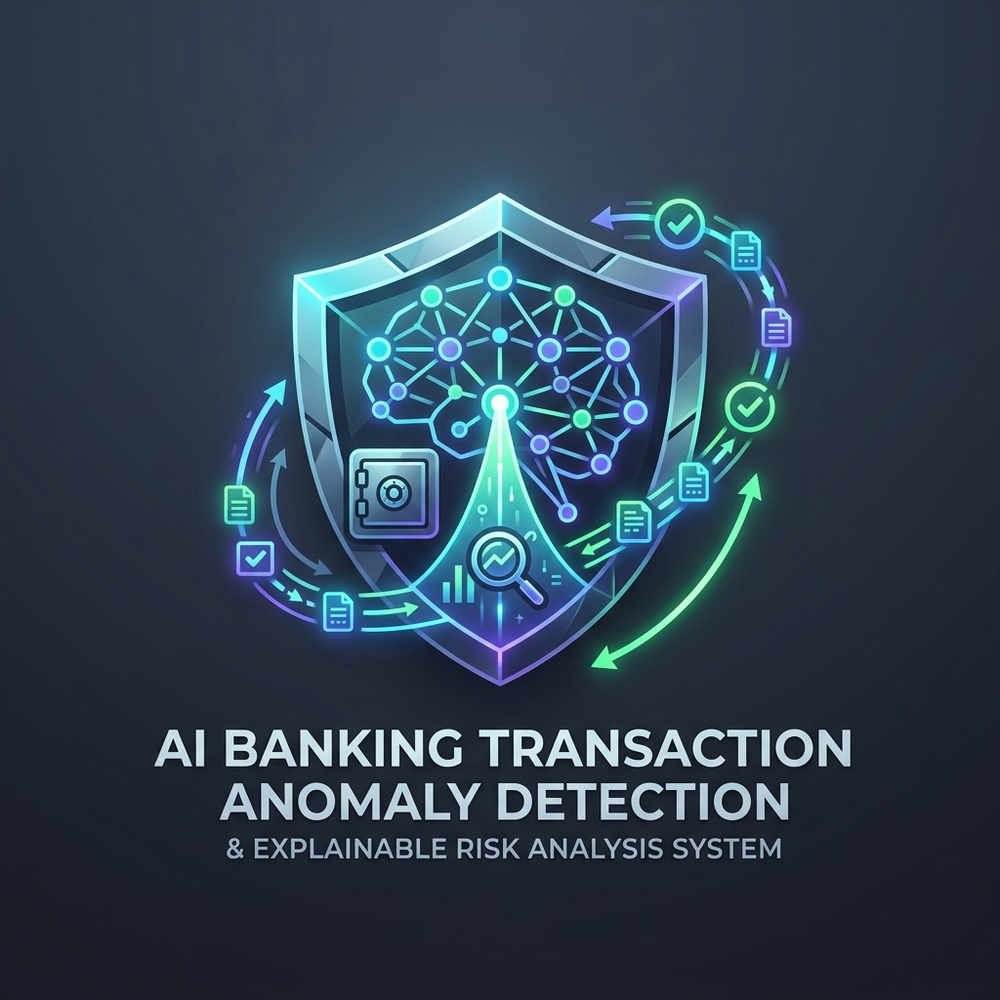

# BankGuard AI — AI Banking Transaction Anomaly Detection & Explainable Risk Analysis System

<div align="center">
  
  <p><strong>Institutional Transaction Anomaly Detection, Adaptive Risk Policy Enforcement, and Explainable AI (XAI)</strong></p>

  
  
  
  
  
</div>

---

## 1. Project Overview

**BankGuard AI** is a full-stack banking transaction monitoring and explainable risk analysis platform built for transparent fraud detection and regulatory auditability. Instead of opaque "black-box" blocks, the system pairs real-time risk scoring with **SHAP-style feature attribution**, **counterfactual ("What-If") recourse**, and a **3-tier adaptive policy engine** (`AUTO_CLEARED`, `STEP_UP_MFA`, `BLOCKED_FROZEN`).

---

## 2. Core Features & Current Status

### Implemented Today
- **Institutional Landing & Interactive Risk Laboratory (`frontend/src/components/`)**
  - Clean, accessible light-mode banking UI with responsive navigation drawer and native `<dialog>` quick search.
  - **Transaction Surveillance Stream** (`LiveTransactionStream.jsx`): Filterable multi-channel feed (`ALL`, `CRITICAL`, `SUSPICIOUS`, `NORMAL`) with pause/resume controls and one-click loading into the Risk Sandbox.
  - **Interactive Risk & XAI Sandbox** (`InteractiveAnomalySandbox.jsx`): 5 attack presets (AML Smurfing, Midnight ATM Cashout, Impossible Travel, Corporate Transfer, Card Testing), live parameter sliders, composite risk score, SHAP attribution bars, and counterfactual recourse guidance.
  - **System Architecture, Model Matrix & Governance Sections** (`ExplainableRiskEngine.jsx`, `ArchitecturePipeline.jsx`, `ModelBenchmarking.jsx`, `InstitutionalCompliance.jsx`).
- **Authentication & Role Onboarding (`backend/main.py`, `backend/auth.py`, `LoginPage.jsx`, `RegisterPage.jsx`)**
  - Bcrypt password hashing, 24-hour HS256 JWT tokens, auto-generated `BG-XXXX-XXXX-XXXX` bank account numbers, and `User` / `Analyst` role registration.
  - Offline demo fallback in `AuthContext.jsx` when the backend server is stopped.
- **PostgreSQL (`pgAdmin 4`) & SQLite Fallback Connector (`backend/database.py`, `DbConfigPage.jsx`)**
  - Dynamic PostgreSQL connection testing and table initialization (`/api/db/status`, `/api/db/connect`, `/api/db/init`).
  - Automatic local SQLite fallback (`bankguard_fallback.db`) so the API boots cleanly even before PostgreSQL is configured.
- **Role-Based Banking Portal (`BankingPortalPage.jsx`)**
  - Sidebar portal with Admin/User switcher, KPI cards, trend & risk distribution charts, transaction inspection modal, transfer simulator, and user directory.

### Planned Engineering Roadmap (Next Sprints)
| Sprint | Milestone | Status | Scope |
| :---: | :--- | :---: | :--- |
| **01** | **UI/UX, Auth & DB Core** | Completed | Institutional landing UI, JWT + Bcrypt auth, PostgreSQL/SQLite persistence |
| **02** | **Hybrid ML/DL + TreeSHAP** | Planned | Train XGBoost, Isolation Forest & PyTorch Autoencoder with real `shap.TreeExplainer` & counterfactuals |
| **03** | **Live Portal Wiring & Graph AI** | Planned | WebSocket stream, atomic transfers + OTP Step-Up MFA, `NetworkX` mule-ring graph, analyst triage |
| **04** | **MLOps, Reports & Docker** | Planned | PSI drift monitoring, batch CSV scanner, SAR/GDPR PDF export, `pytest` suite & Docker Compose |

---

## 3. Repository Structure

```text
AI-Banking-Transaction-Anomaly-Detection/
├── backend/
│   ├── main.py                # FastAPI app: Auth, DB management, Transactions & Audit APIs
│   ├── database.py            # SQLAlchemy engine (PostgreSQL + automatic SQLite fallback)
│   ├── models.py              # ORM tables: users, transactions, security_audits
│   ├── schemas.py             # Pydantic request/response schemas
│   ├── auth.py                # Bcrypt password hashing & JWT token utilities
│   ├── init_db.py             # CLI PostgreSQL database & table initializer
│   ├── schema.sql             # pgAdmin 4 SQL schema and seed script
│   ├── requirements.txt       # Python backend dependencies
│   ├── .env.example           # Sample environment variables
│   └── README.md              # Backend & pgAdmin 4 reference
├── frontend/
│   ├── public/assets/         # Brand logo and static icons
│   ├── src/
│   │   ├── components/        # Navbar, Hero, LiveTransactionStream, InteractiveAnomalySandbox,
│   │   │                      # ExplainableRiskEngine, ArchitecturePipeline, ModelBenchmarking,
│   │   │                      # InstitutionalCompliance, Footer
│   │   ├── context/           # AuthContext.jsx (JWT session, hash routing, DB status)
│   │   ├── pages/             # LoginPage, RegisterPage, BankingPortalPage, DbConfigPage
│   │   ├── App.jsx            # Root layout & page router
│   │   ├── index.css          # Design tokens, accessible focus & dialog styles
│   │   └── main.jsx           # React 19 entry point
│   ├── index.html
│   ├── package.json
│   └── vite.config.js
└── README.md                  # Project documentation
```

---

## 4. Step-by-Step Local Setup & Execution

### Prerequisites
- **Python** `3.10+`
- **Node.js** `18+` & **npm** `9+`
- **PostgreSQL / pgAdmin 4** *(optional — backend automatically falls back to local SQLite if PostgreSQL is not running)*

### Step 1: Clone the Repository
```bash
git clone https://github.com/VigneshMP21/AI-Banking-Transaction-Anomaly-Detection.git
cd AI-Banking-Transaction-Anomaly-Detection
```

### Step 2: Configure & Start the Backend (FastAPI)
```bash
cd backend
pip install -r requirements.txt
```

*(Optional)* Copy `backend/.env.example` to `backend/.env` and update your PostgreSQL credentials (`POSTGRES_USER`, `POSTGRES_PASSWORD`, `POSTGRES_DB=sample_bank`). Then start the API server:

```bash
python -m uvicorn main:app --reload --port 8000
```

- API Base URL: `http://localhost:8000`
- Interactive Swagger Docs: `http://localhost:8000/docs`

### Step 3: Start the Frontend (React + Vite)
Open a second terminal:

```bash
cd frontend
npm install
npm run dev
```

- Application URL: **`http://localhost:5173`**
- Database Config UI: **`http://localhost:5173/#/db-config`**

### Step 4: Build & Lint Verification (Frontend)
```bash
cd frontend
npm run lint
npm run build
```

---

## 5. Seeded Demo Accounts

When the backend starts on an empty database, two demo accounts are seeded automatically:

| Role | Email / Username | Password | Portal View |
| :--- | :--- | :--- | :--- |
| **Risk Analyst** | `alex.vance@bankguard.ai` / `alex_vance` | `BankGuard2026!` | Admin / Risk Operations |
| **Customer** | `elena.rostova@bankguard.ai` / `elena_rostova` | `BankGuard2026!` | Client Banking View |

---

## 6. Governance & Ethics

BankGuard AI is designed around **GDPR Article 22 (Right to Explanation)** and **Basel III** operational risk traceability principles: automated blocks or step-up challenges are paired with transparent feature attribution, counterfactual recourse, and human-in-the-loop review logs.
